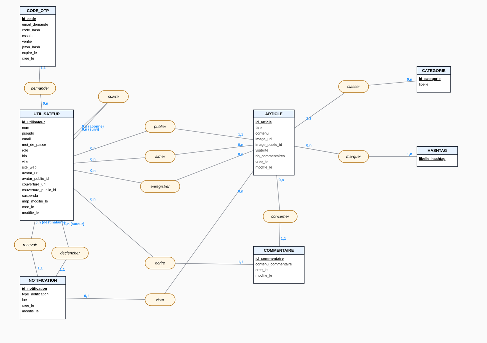

# Analyse des données de Solola

Modèle Merise du backend (`backend/src/models`), en deux niveaux :

- **MCD** (modèle conceptuel) : dans [`solola.loo`](solola.loo), à ouvrir avec [Looping](https://www.looping-mcd.fr). L'onglet MLD de Looping en dérive automatiquement le modèle logique.
- **MLD** (modèle logique) : reproduit plus bas, avec le dictionnaire des données.

> L'image est un aperçu généré à partir du fichier, pour le lire sans Looping. Dans Looping, le rendu suit son propre style ; les objets se déplacent librement si tu veux réorganiser le schéma.

## Règles de gestion

1. Un utilisateur s'inscrit avec un nom, un pseudo et un email uniques. Il a le rôle **lecteur**, **auteur** ou **admin**.
2. Seuls les auteurs (et les admins) publient des articles. Un article est publié par un seul utilisateur.
3. Un article appartient à une seule catégorie, prise dans une liste fixe. Une catégorie regroupe zéro ou plusieurs articles.
4. Un article peut porter plusieurs hashtags, extraits de son contenu. Un hashtag existe dès qu'au moins un article le porte.
5. Un article est **public** ou réservé aux **abonnés** de son auteur.
6. Un utilisateur connecté peut aimer et enregistrer autant d'articles qu'il veut, une seule fois chacun.
7. Un commentaire est écrit par un seul utilisateur et concerne un seul article.
8. Un utilisateur peut suivre d'autres utilisateurs ; il ne peut pas se suivre lui-même.
9. Une notification est envoyée à un destinataire et déclenchée par un autre utilisateur. Elle vise un article pour un like ou un commentaire, et aucun pour un abonnement.
10. Pour récupérer son compte, un utilisateur demande un code à 6 chiffres. Ce code expire après 10 minutes et accepte 5 essais au plus.

## MCD

| Association | Lien 1 | Lien 2 | Sens |
|---|---|---|---|
| `publier` | UTILISATEUR **0,n** | ARTICLE **1,1** | Un article a un auteur |
| `classer` | ARTICLE **1,1** | CATEGORIE **0,n** | Un article a une catégorie |
| `marquer` | ARTICLE **0,n** | HASHTAG **1,n** | Hashtags d'un article |
| `aimer` | UTILISATEUR **0,n** | ARTICLE **0,n** | Likes |
| `enregistrer` | UTILISATEUR **0,n** | ARTICLE **0,n** | Articles enregistrés |
| `suivre` | UTILISATEUR **0,n** (abonné) | UTILISATEUR **0,n** (suivi) | Abonnements, association réflexive |
| `ecrire` | UTILISATEUR **0,n** | COMMENTAIRE **1,1** | Auteur d'un commentaire |
| `concerner` | COMMENTAIRE **1,1** | ARTICLE **0,n** | Article commenté |
| `recevoir` | UTILISATEUR **0,n** (destinataire) | NOTIFICATION **1,1** | Destinataire |
| `declencher` | UTILISATEUR **0,n** (auteur) | NOTIFICATION **1,1** | Auteur de l'action |
| `viser` | NOTIFICATION **0,1** | ARTICLE **0,n** | Article concerné, s'il y en a un |
| `demander` | UTILISATEUR **0,n** | CODE_OTP **1,1** | Récupération de compte |

## MLD

Notation : clé primaire <u>soulignée</u>, clé étrangère précédée de `#`.

- **UTILISATEUR** ( <u>id_utilisateur</u>, nom, pseudo, email, mot_de_passe, role, bio, ville, site_web, avatar_url, avatar_public_id, couverture_url, couverture_public_id, suspendu, mdp_modifie_le, cree_le, modifie_le )
- **ARTICLE** ( <u>id_article</u>, titre, contenu, image_url, image_public_id, visibilite, nb_commentaires, cree_le, modifie_le, #id_utilisateur, #id_categorie )
- **CATEGORIE** ( <u>id_categorie</u>, libelle )
- **HASHTAG** ( <u>libelle_hashtag</u> )
- **COMMENTAIRE** ( <u>id_commentaire</u>, contenu_commentaire, cree_le, modifie_le, #id_utilisateur, #id_article )
- **NOTIFICATION** ( <u>id_notification</u>, type_notification, lue, cree_le, modifie_le, #id_utilisateur, #id_utilisateur_1, #id_article )
- **CODE_OTP** ( <u>id_code</u>, email_demande, code_hash, essais, verifie, jeton_hash, expire_le, cree_le, #id_utilisateur )
- **aimer** ( <u>#id_utilisateur</u>, <u>#id_article</u> )
- **enregistrer** ( <u>#id_utilisateur</u>, <u>#id_article</u> )
- **suivre** ( <u>#id_utilisateur</u>, <u>#id_utilisateur_1</u> )
- **marquer** ( <u>#id_article</u>, <u>#libelle_hashtag</u> )

### Clés étrangères

| Table | Colonne | Référence | Obligatoire | Vient de |
|---|---|---|---|---|
| ARTICLE | id_utilisateur | UTILISATEUR.id_utilisateur | oui | `publier` |
| ARTICLE | id_categorie | CATEGORIE.id_categorie | oui | `classer` |
| COMMENTAIRE | id_utilisateur | UTILISATEUR.id_utilisateur | oui | `ecrire` |
| COMMENTAIRE | id_article | ARTICLE.id_article | oui | `concerner` |
| NOTIFICATION | id_utilisateur | UTILISATEUR.id_utilisateur | oui | `recevoir` (destinataire) |
| NOTIFICATION | id_utilisateur_1 | UTILISATEUR.id_utilisateur | oui | `declencher` (auteur de l'action) |
| NOTIFICATION | id_article | ARTICLE.id_article | non | `viser` |
| CODE_OTP | id_utilisateur | UTILISATEUR.id_utilisateur | oui | `demander` |
| aimer, enregistrer | id_utilisateur, id_article | UTILISATEUR, ARTICLE | oui | association n,n |
| suivre | id_utilisateur (abonné), id_utilisateur_1 (suivi) | UTILISATEUR | oui | association réflexive |
| marquer | id_article, libelle_hashtag | ARTICLE, HASHTAG | oui | association n,n |

Quand une table reçoit deux fois la même clé, Looping suffixe la seconde (`_1`). Dans Looping, la boîte de dialogue d'un lien permet de renommer ces clés (par exemple `id_destinataire` et `id_auteur`).

## Dictionnaire des données

| Entité | Attribut | Type | Contraintes | Description |
|---|---|---|---|---|
| UTILISATEUR | id_utilisateur | COUNTER | identifiant | `_id` MongoDB |
| | nom | VARCHAR(60) | non nul | |
| | pseudo | VARCHAR(30) | non nul, unique | lettres, chiffres, `_` ou `.` ; en minuscules |
| | email | VARCHAR(255) | non nul, unique | en minuscules |
| | mot_de_passe | CHAR(60) | non nul | empreinte bcrypt, jamais renvoyée par l'API |
| | role | VARCHAR(10) | non nul | `reader`, `author` ou `admin` |
| | bio | VARCHAR(160) | | |
| | ville | VARCHAR(60) | | |
| | site_web | VARCHAR(120) | | commence par `http://` ou `https://` |
| | avatar_url, couverture_url | VARCHAR(255) | | images Cloudinary |
| | avatar_public_id, couverture_public_id | VARCHAR(255) | | pour supprimer l'ancienne image |
| | suspendu | BOOLEAN | non nul | un compte suspendu ne peut plus se connecter |
| | mdp_modifie_le | DATETIME | | sessions émises avant cette date refusées |
| | cree_le, modifie_le | DATETIME | non nul | |
| ARTICLE | id_article | COUNTER | identifiant | |
| | titre | VARCHAR(150) | non nul | |
| | contenu | TEXT | non nul | 10 000 caractères max |
| | image_url, image_public_id | VARCHAR(255) | | image Cloudinary |
| | visibilite | VARCHAR(10) | non nul | `public` ou `followers` |
| | nb_commentaires | INT | non nul | compteur dénormalisé |
| | cree_le, modifie_le | DATETIME | non nul | |
| CATEGORIE | id_categorie | COUNTER | identifiant | |
| | libelle | VARCHAR(30) | non nul, unique | Art et dessin, Design, Photographie, Technologie, Musique, Voyage, Lifestyle, Manga, Autre |
| HASHTAG | libelle_hashtag | VARCHAR(50) | identifiant | en minuscules, sans `#` ; 15 par article au plus |
| COMMENTAIRE | id_commentaire | COUNTER | identifiant | |
| | contenu_commentaire | VARCHAR(1000) | non nul | |
| | cree_le, modifie_le | DATETIME | non nul | |
| NOTIFICATION | id_notification | COUNTER | identifiant | |
| | type_notification | VARCHAR(10) | non nul | `like`, `comment` ou `follow` |
| | lue | BOOLEAN | non nul | |
| | cree_le, modifie_le | DATETIME | non nul | |
| CODE_OTP | id_code | COUNTER | identifiant | |
| | email_demande | VARCHAR(255) | non nul | |
| | code_hash | CHAR(60) | non nul | code à 6 chiffres haché avec bcrypt |
| | essais | SMALLINT | non nul | 5 au plus |
| | verifie | BOOLEAN | non nul | |
| | jeton_hash | CHAR(64) | | SHA-256 du jeton de réinitialisation, à usage unique |
| | expire_le | DATETIME | non nul | 10 minutes, supprimé automatiquement (index TTL) |
| | cree_le | DATETIME | non nul | |

## Correspondance avec MongoDB

Le backend utilise MongoDB : certaines associations ne sont pas des collections mais des champs.

| Élément Merise | Dans MongoDB |
|---|---|
| UTILISATEUR, ARTICLE, COMMENTAIRE, NOTIFICATION, CODE_OTP | collections `users`, `posts`, `comments`, `notifications`, `otps` |
| CATEGORIE | champ `category` de `posts`, valeur de la liste `utils/categories.js` |
| HASHTAG, `marquer` | tableau `tags` de `posts` |
| `aimer`, `enregistrer` | tableaux `likes` et `saves` de `posts` (identifiants d'utilisateurs) |
| `suivre` | tableaux `following` et `followers` de `users`, tenus à jour ensemble |
| `publier`, `ecrire`, `concerner` | champs `author` et `post` |
| `recevoir`, `declencher`, `viser` | champs `recipient`, `actor` et `post` de `notifications` |
| `demander` | lien par le champ `email` de `otps`, pas par l'identifiant |
| images (avatar, couverture, article) | sous-document `{ url, publicId }` |

Si le projet passe un jour sur une base relationnelle (PostgreSQL avec Prisma, par exemple), le MLD ci-dessus sert de schéma de départ. Looping génère aussi le script SQL depuis son onglet dédié.
